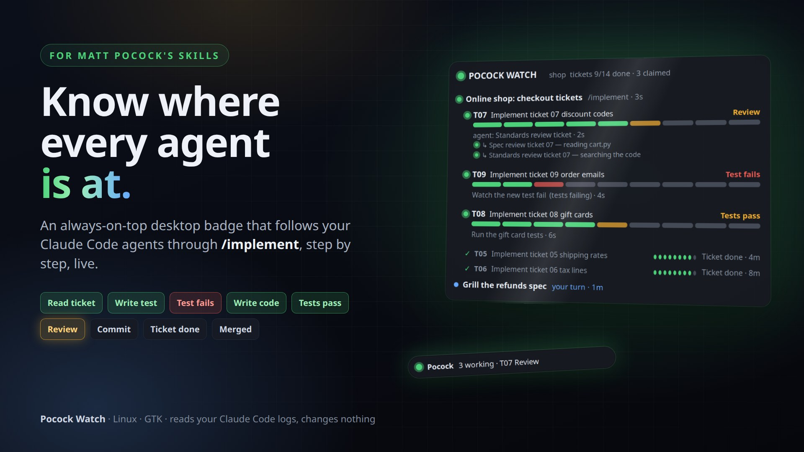
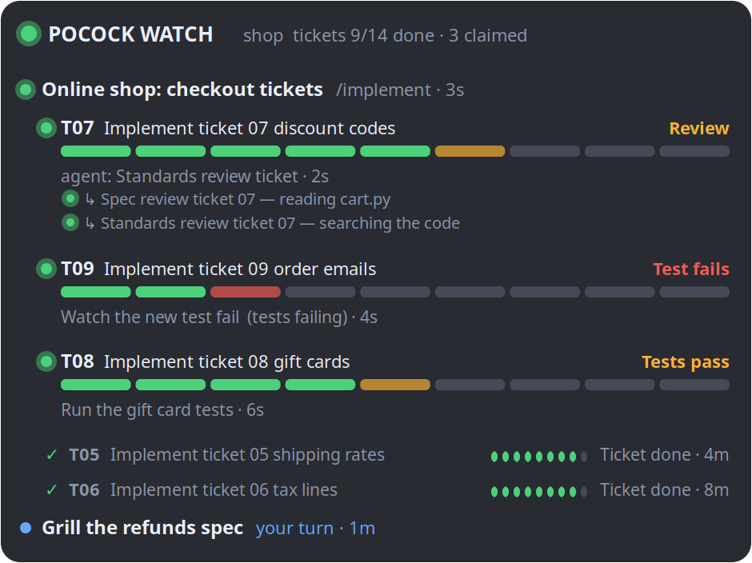

# Pocock Watch

**An always-on-top desktop badge that shows where each of your Claude Code agents is in Matt Pocock's `/implement` flow.**



If you build with [Matt Pocock's skills](https://github.com/mattpocock/skills), one ticket per agent, you end up with several agents working at once and no easy way to see how far each one has got. Pocock Watch sits on your desktop and keeps you posted:

**Read ticket → Write test → Test fails → Write code → Tests pass → Review → Commit → Ticket done → Merged**

| Open | Closed to a pill |
|:---:|:---:|
|  |  |

<sub>The pictures are drawn by the badge's own code from made-up demo agents (`python3 pocock_watch.py --demo`).</sub>

## What it shows

- **Each Claude Code session**: its title, its latest skill (`/implement`, `/tdd`, `/grill-with-docs`…) and what it is doing now, or **your turn** when it's waiting for you.
- **Each ticket agent** (a sub-agent such as "Implement ticket 07…"): a 9-step bar with the current step pulsing, and the last thing it did ("Watch the new test fail · 4s"). Its review agents are listed underneath.
- **Finished agents** shrink to one line with a ✓.
- **Ticket progress** in the header, counted from the `Status:` lines in your repo's `tickets/` folder. Ticket worktrees named `repo-tNN` count towards `repo`.
- **Desktop notifications** when an agent finishes, commits, marks its ticket done or merges, and when a session is waiting for you.

Click to open or close the list. Drag to move it, and it remembers where. Right-click for options and Quit.

## How it works

It reads the session logs Claude Code already writes to `~/.claude/projects/` (only the new lines each refresh) and works out the step from the agent's tool calls: editing a test file, a test run failing or passing, starting a review agent or `/matt-code-review`, `git commit`, `Status: done`, `git merge`. It never changes anything. The steps are a close guide rather than exact, because they're read from what the agent does.

## Requirements

- Linux on X11 (made on Linux Mint Cinnamon).
- Python 3 with PyGObject (GTK 3) and pycairo. They are usually preinstalled on Mint and Ubuntu; if not:
  ```
  sudo apt install python3-gi python3-gi-cairo
  ```
- `notify-send` for the notifications (optional).

## Run it

```
git clone https://github.com/lofty-nz/pocock-watch.git
cd pocock-watch
python3 pocock_watch.py          # your real sessions
python3 pocock_watch.py --demo   # made-up agents, to try it out
```

To start it with your desktop, add `python3 /path/to/pocock_watch.py` to your startup applications. Settings are kept in `~/.config/pocock-watch/settings.json`.

## Development

- Tests: `python3 -m unittest discover tests` (made-up logs only).
- Rebuild the README pictures: `docs/render.sh` (needs a headless Chromium and Pillow).

Not affiliated with Matt Pocock or Anthropic.
